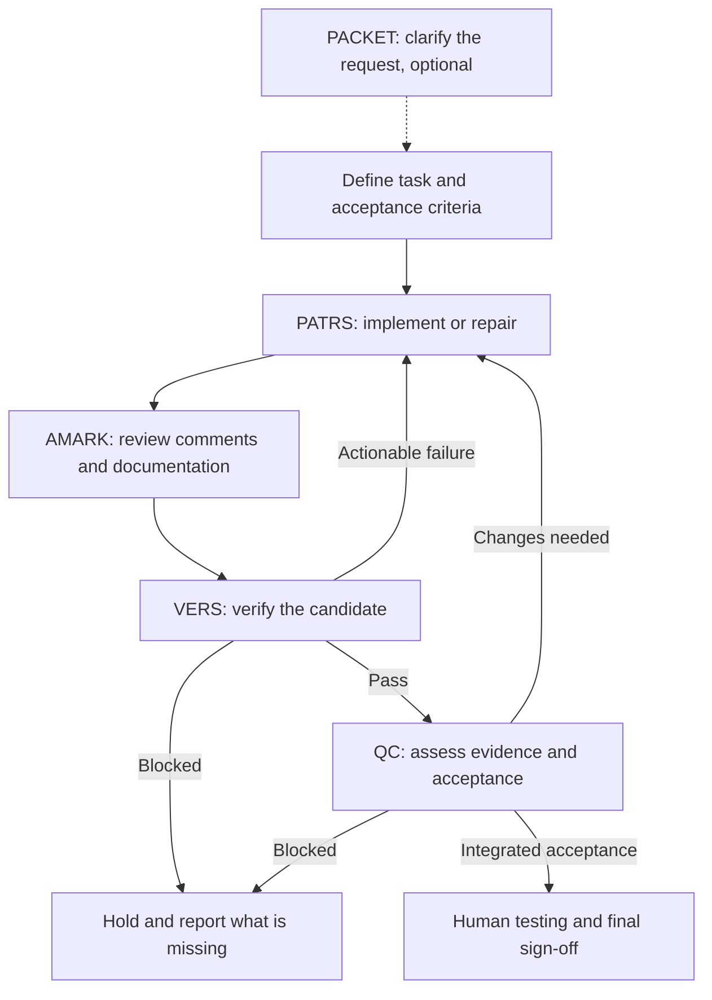
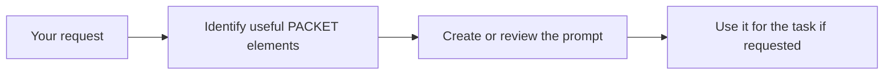
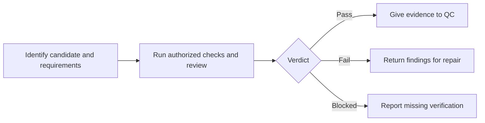
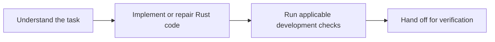
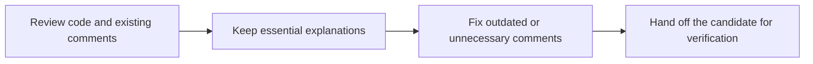
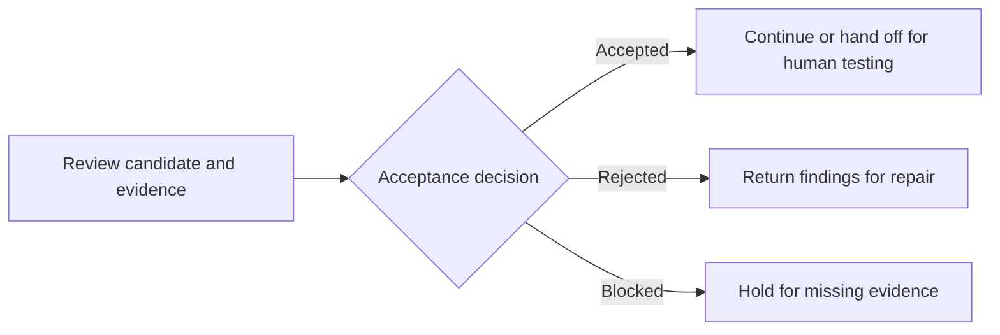

# Skillz Library

A collection of reusable agent skills. Each skill lives in its own folder under `skills/` and contains a `SKILL.md` file.

## Skills

| Skill | Purpose |
| --- | --- |
| [AMARK](skills/amark/SKILL.md) | Keep Rust comments and documentation minimal, purposeful, and useful for maintenance. |
| [PACKET](skills/packet/SKILL.md) | Create, improve, or review prompts using Persona, Action, Context, Keywords, Examples, and Target output or Tone. |
| [PATRS](skills/patrs/SKILL.md) | Develop idiomatic Rust with practical patterns and minimal abstractions. |
| [QC](skills/qc/SKILL.md) | Govern Rust file and project acceptance, checkpoints, and human test handoff using verification evidence. |
| [UT_MODE](skills/ut-mode/SKILL.md) | Coordinate end-to-end Rust development, verification, repair, and QC. |
| [VERS](skills/vers/SKILL.md) | Independently verify Rust projects with executable checks and evidence. |

## UT_MODE: coordinate Rust development

[UT_MODE](skills/ut-mode/SKILL.md) coordinates the Rust skills through implementation, review, verification, and acceptance. Start it with `$ut-mode` and a description of the work.



After a repair, the changed candidate goes through applicable checks and verification again before QC reassesses it. A blocked gate stays on hold until the missing evidence or dependency is available; it does not automatically trigger a repair loop. Human testing and explicit sign-off are needed for completion.

Install `ut-mode`, `patrs`, `amark`, `vers`, and `qc` separately; `packet` is optional. Each skill also works on its own. See the [integration guide](skills/ut-mode/references/integration.md) for installation and handoffs.

## Use PACKET with Codex

PACKET can clarify a request for any task, including a Rust task before UT_MODE starts.



Install the skill from this repository by asking Codex:

```text
$skill-installer Install the skill from https://github.com/SampleBias/skillz_library/tree/main/skills/packet
```

Start a new Codex session after installation, then try:

```text
$packet Help me create a prompt for a beginner-friendly lesson on budgeting.
```

See the [license](LICENSE) for terms.

## VERS: verify Rust projects

[VERS](skills/vers/SKILL.md) is an independent Rust verification skill. Its harness records Cargo checks, runtime contracts, candidate identity and evidence, and can incorporate qualifying independent reviews before producing a verdict.



After these files have been committed and pushed, install it through a compatible skill host from `https://github.com/SampleBias/skillz_library/tree/main/skills/vers`, then reload the host and invoke `$vers`. The verifier can also run directly using `skills/vers/scripts/verify.sh --root /path/to/project --execute`. Read the [integration guide](skills/vers/references/integration.md) before running project code; the harness does not sandbox it.

## PATRS: develop Rust projects

[PATRS](skills/patrs/SKILL.md) guides Rust implementation and repairs using patterns suited to the task. Install it through a compatible skill host from `https://github.com/SampleBias/skillz_library/tree/main/skills/patrs`, reload the host, and invoke `$patrs`. Use `$vers` separately for independent verification when available.



## AMARK: annotate Rust deliberately

[AMARK](skills/amark/SKILL.md) keeps Rust comments focused on safety, non-obvious decisions, necessary workarounds, and public API contracts. Install it through a compatible skill host from `https://github.com/SampleBias/skillz_library/tree/main/skills/amark` after the changes are published, reload the host, and invoke `$amark`. Use `$patrs` for development, `$amark` for annotation quality, and `$vers` for independent verification; repair findings and return the changed candidate for review.



## QC: govern Rust acceptance and checkpoints

[QC](skills/qc/SKILL.md) evaluates file and integrated project acceptance after PATRS, AMARK, and VERS. It records evidence-based scores and lifecycle decisions and holds when mandatory verification is incomplete. The [skill package](skills/qc/README.md) is a manual specification and starter configuration, not an executable checkpoint controller. After publication, install `skills/qc` through a compatible skill host, reload it, and invoke `$qc`.



VERS v0.2 can pass when automated checks and qualifying independent reviews are complete. Reviewer provenance and independence must be verified outside the harness; strict-mode additional coverage remains blocked. QC requires a qualifying VERS pass before acceptance.
