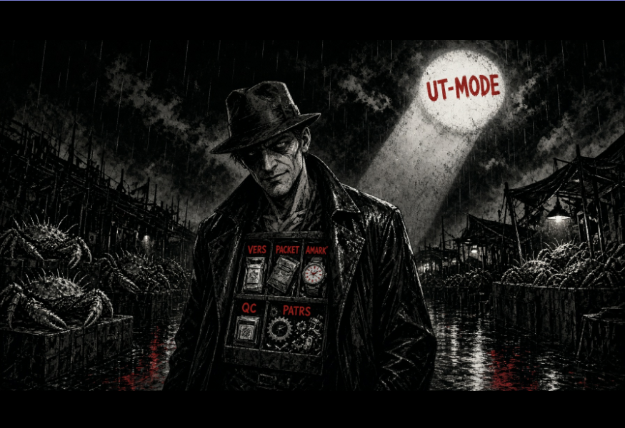
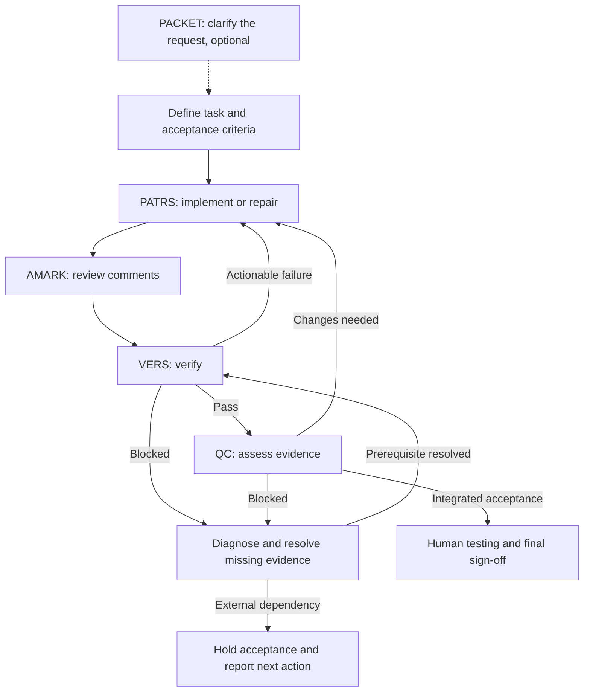

# skillz_library



i'm samplebias. i write rust. i also write a lot of agent prompts that turn into rust. after watching agents cheerfully invent comments, skip verification, and declare victory on a green `cargo test`, i got tired of cleaning up after them.

this is my answer: a small set of skills that put work through implementation, minimal comments, independent verification, and an acceptance gate before anyone gets to call it done.

if you want to go fast, go deep first. throughput without evidence is just expensive slop.

## the skills

| skill | what it actually does |
| --- | --- |
| [packet](skills/packet/SKILL.md) | turns a vague request into a prompt that has a chance of producing useful output |
| [patrs](skills/patrs/SKILL.md) | writes or repairs idiomatic rust without inventing abstractions you don't need |
| [amark](skills/amark/SKILL.md) | keeps comments short and real: safety, non-obvious decisions, workarounds, and public contracts |
| [vers](skills/vers/SKILL.md) | independently verifies; treats the code and the implementer's claims as untrusted, and reports pass / fail / blocked with evidence |
| [qc](skills/qc/SKILL.md) | the acceptance gate: scores the evidence, decides accept / reject / block, and controls the handoff for human testing |
| [ut-mode](skills/ut-mode/SKILL.md) | the orchestrator: runs the others in order, repairs failures, and works through blocks when it can |

## how i actually use them

start with `$ut-mode`, a description of the work, and what “done” looks like. it loads the others, implements or repairs with patrs, runs amark, verifies with vers, and only then lets qc make a call.

you can also use any of them alone. `$vers` on a crate you don't trust. `$packet` when the request is still fuzzy. `$amark` when the comments have started narrating the code. packet is optional; the rest make up the rust workflow.



blocked means “we don't have the evidence yet.” investigate the cause, resolve authorized prerequisites, and continue work that doesn't depend on acceptance. retry after something relevant changes; otherwise report the dependency. human testing and explicit sign-off are still required for completion. qc is a manual specification, not an executable checkpoint controller.

## failure modes you can try

[the demo](examples/demo/README.md) runs a tiny rust crate through the real harness. it shows a runtime contract catching broken help text while tests pass, a failing unit test, and a block caused by missing independent reviews. it also exercises the pass path with **fabricated review records**: that's a protocol test, not a real independent review or qc acceptance.

```bash
python3 examples/demo/run.py
```

vers reports an observed mandatory failure as `FAIL`; missing mandatory evidence is `BLOCKED`. when both occur, failure takes precedence and blocked checks remain in the report. qc rejects failed mandatory checks and holds on missing evidence. the [illustrative qc report](skills/qc/examples/checkpoint.example.json) shows the format, not a real acceptance.

## install

install the skills you want; they live under `skills/<name>/`. for packet on codex:

```text
$skill-installer Install the skill from https://github.com/SampleBias/skillz_library/tree/main/skills/packet
```

then start a new session and try `$packet`. install `ut-mode`, `patrs`, `amark`, `vers`, and `qc` separately for the full workflow. see the [host installation guide](docs/integration.md) for codex, claude code, cursor, and grok build.

vers can also run directly:

```bash
skills/vers/scripts/verify.sh --root /path/to/project --execute
```

read the [vers integration guide](skills/vers/references/integration.md) first. the harness does not sandbox project code. a real pass requires qualifying independent reviews and an operator who has checked their provenance; the harness cannot establish either on its own. strict mode's extra coverage remains blocked.

## why these exist

agents are great at producing plausible rust. they are less great at knowing when they are wrong. these skills make the “is this actually good?” step explicit, repeatable, and hard to skip.

fork it. improve it. make it yours. if you add a useful check or a better gate, send a PR. the [contributor guide](CONTRIBUTING.md) has the details; [the changelog](CHANGELOG.md) tracks changes.

license is MIT. see [LICENSE](LICENSE).
